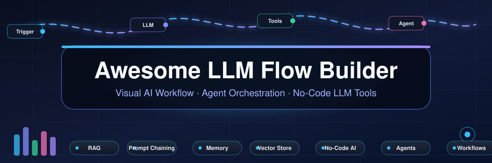

# 🚀 Awesome LLM Flow Builder — Visual AI Workflow, Agent Orchestration & No-Code LLM Tools

> Curated, regularly updated directory of **LLM flow builders**: visual **prompt-chaining** and **AI workflow** designers, **agent orchestration** platforms, **RAG pipeline** builders and **no-code AI app** builders — split into priced and compared hosted **SaaS** products and self-hostable **open-source** GitHub repositories.

## 🌐 Top LLM Flow Builder Ecosystem

**Curated List of SaaS Products & Open-Source GitHub Projects**  

*Focused on Visual Workflow Design, Agent Orchestration & No-Code AI Development*  

**📅 Last updated: March 2026**

**Also searched as:** visual LLM workflow builder · prompt chaining tool · agent orchestration canvas · no-code AI builder · chatbot flow designer · RAG pipeline builder · LangChain visual UI · Flowise alternative · Voiceflow alternative · open-source n8n alternative · Copilot Studio alternative

This repository tracks notable **SaaS platforms** and **open-source projects** for **LLM Flow Builders**. These tools provide visual drag-and-drop interfaces for designing LLM workflows, chaining prompts with tools and memory, building RAG pipelines, and deploying AI agents without extensive coding.

🏆 **Examples** include Voiceflow, Botpress, Microsoft Copilot Studio, LangChain, Flowise, Retool, Stack AI, Dialogflow, Cognigy, and Kore.ai (the category leaders).

🔓 **Open-source emphasis**: This section is heavily expanded with every major active project for self-hosting, custom node development, and transparent workflow orchestration — ideal for AI engineers, product teams, and developers building vendor-neutral AI applications.

🎉 Contributions welcome! Open a PR to add/update entries. Keep descriptions factual and link to official sites.

## 🤔 What Is an LLM Flow Builder?

An **LLM flow builder** — also called an **AI workflow builder**, **visual prompt editor**, **agent orchestration canvas**, **no-code AI builder** or **chatbot flow designer** — is a drag-and-drop interface for wiring together LLM prompts, tools, memory, retrieval (RAG) steps and API calls into a working AI application, instead of hand-writing the orchestration code. These tools are the fastest way to prototype chatbots, voice agents and multi-agent pipelines, and most of them export the flow to runnable code or deploy it as an API.

🎯 **Typical use cases**: conversational agents and voice bots, document-QA / RAG chatbots, multi-agent pipelines, internal AI tools, and production prompt-chaining with evaluation and versioning. 🧭 **How to choose**: hosted SaaS (Voiceflow, Botpress, Microsoft Copilot Studio, Cognigy) suits teams that want managed infrastructure and compliance, while open-source builders (Flowise, Langflow, Dify, n8n, Windmill) suit engineers who need self-hosting, custom nodes and zero vendor lock-in.

## 📑 Table of Contents

- 📖 [What Is an LLM Flow Builder?](#-what-is-an-llm-flow-builder)

- 📊 [Sector Overview & Market Dynamics](#-sector-overview--market-dynamics)

- 🧰 [SaaS/Hosted Platforms](#-saashosted-platforms)

- 🧩 [Open-Source GitHub Projects](#-open-source-github-projects)

- 🤝 [How to Contribute](#-how-to-contribute)

- ⚠️ [Disclaimer](#-disclaimer)

## 📊 Sector Overview & Market Dynamics

💰 **Estimated market size:** the broader conversational-AI market these builders feed into is worth roughly **$14.3B in 2025** and is forecast to grow at **~23.8% CAGR (2026–2033)**, while the narrower no-code AI platform market — the closest proxy for visual LLM/agent flow builders — was **$4.28B in 2024** growing at **~30.2% CAGR (2025–2033)** (Grand View Research).

🧱 **Concentration:** this is a **moderately fragmented, not winner-take-all** sector — hyperscalers (Dialogflow, Copilot Studio), funded vertical vendors (Cognigy, Kore.ai, Voiceflow, Retool, Stack AI) and a deep open-source tier (Flowise, Langflow, Dify, n8n) all hold real share, so no single platform dominates and enterprise buyers routinely run two or more; fragmentation is, however, slowly narrowing as incumbents acquire (e.g. NICE/Cognigy, Workday/Flowise).

## 🧰 SaaS/Hosted Platforms

| Product | 📝 Description | 💲 Pricing (starting tier) | 🎁 Free Tier / Trial Limits | 🏢 Company Size (revenue / valuation) |
|---|---|---|---|---|
| **[Dialogflow (Google)](https://cloud.google.com/dialogflow)** | 💬 Google's conversational AI platform for building chatbots and voice assistants with visual intent/entity editor and fulfillment webhooks. | **ES Essentials $0.002/text request**; **CX $0.007/text request**; CX audio **$0.06/minute ($3.60/hour)**; ES audio output $4–$16 per million characters. | **Dialogflow ES Trial Edition — free forever at 180 text requests/minute** (audio 100 requests/min, 1,000/day, 15,000/month, 60 s max per request); **new CX customers get a $600 credit valid 12 months**. | **$402.8B revenue** (Alphabet FY2025 — Dialogflow not broken out) |
| **[Microsoft Copilot Studio](https://www.microsoft.com/en-us/microsoft-copilot/microsoft-copilot-studio)** | 🪟 Microsoft's low-code platform for building custom copilots integrated with the Power Platform and Microsoft 365 ecosystem. | **$200/mo per capacity pack = 25,000 Copilot Credits** (tenant-wide prepaid), or **$0.01 per Copilot Credit** pay-as-you-go via Azure. | **Free trial license ≈ 30 days** (extendable by a further **30 days**; trial environments also expire after **30 days**): build and test agents in the test panel — **publishing is disabled** during the trial. | **$281.7B revenue** (Microsoft FY2025 — Copilot Studio not broken out) |
| **[Retool](https://retool.com/)** | 🛠️ Low-code platform for building internal tools and workflows with AI capabilities; Windmill serves as the leading open-source alternative. | **Team $10/mo per builder + $5/mo per internal user** (billed annually); **Business $50/mo per builder + $15/mo per internal user**; external users $8/user/mo (51–250) down to $4/user/mo (500+). | **Free plan — free forever:** **up to 5 users**, **250 pooled AI credits/month**, cloud-hosted production apps (external users/embedded apps not included). | **$3.2B valuation** (2022 Series C-2; ~$120M ARR est. 2025) |
| **[Cognigy](https://www.cognigy.com/)** | 🗣️ Enterprise conversational AI platform with visual flow editor for voice and chat automation; used by large contact centers. | **$43,080/yr** for the Basic 5K plan (60,000 conversations/year) via AWS Marketplace; **$53,916/yr** Basic 5K + 5 Voice Gateways; enterprise ELA from **$200,000/yr** (up to 10M conversations/yr at $1,000,000/yr). | **Free trial — 30 days** (vendor-advertised Cognigy.AI trial, self-service at trial.cognigy.ai; no free-forever tier). | **~$955M valuation** (acquired by NICE, 2025) |
| **[Kore.ai](https://kore.ai/)** | 🤖 Enterprise virtual assistant platform with Bot Builder for designing NLP-enabled bots with security and SAP/Salesforce integration. | Self-serve tiers from **$29/mo** (Contact Center AI Essential) and **$60/mo** (Automation AI Essential); AWS Marketplace SKU **$6,600/yr per 660,000 AI-for-Service units** ($33,000/yr Interaction Gateway); full platform quote-based. | **Free trial with $500 starting credit** (rate-limited to **20 requests/minute**, includes Conversation Designer, Dialog Builder, Knowledge Graph and Multi-Engine NLP); credit reported **valid 90 days**. | **$150M growth investment** (2024; valuation undisclosed) |
| **[Botpress](https://botpress.com/)** | 💭 Open-source conversational AI platform (with hosted cloud option) featuring visual flow builder, built-in NLU, knowledge bases, and multi-channel deployment. | **Plus $150/mo billed annually** ($189 month-to-month) — 250 conversations/mo, $25 AI usage, 3 seats; **Team $750/mo billed annually** ($939 monthly) — 1,500 conversations/mo, $150 AI usage, unlimited seats. | **Free plan — free forever:** **100 conversations, 3 seats, 3 AI agents**, no overages/top-ups; workspace-level limits (not a timed trial). | **$120M valuation** (2025 Series B; $45M total funding) |
| **[Voiceflow](https://www.voiceflow.com/)** | 🎙️ Collaborative conversational AI design platform with visual flow builder for voice and chat assistants; popular for prototyping and team collaboration. | **Pro $60/mo** (10,000 message credits; $54/mo equivalent billed annually at $648/yr), extra editor seats **$50/mo** each; **Business from $150/mo** (30,000 credits), up to $500/mo (100,000 credits). | **Free Starter plan — free forever, not a trial:** a **one-time 100-message-credit grant that does not renew**, plus **2 projects/agents and 1 editor seat** (no monthly credit refresh). | **$105M valuation** (2024; $35M raised to date) |
| **[Stack AI](https://www.stack-ai.com/)** | 📚 No-code platform for building AI workflows and applications with visual drag-and-drop interface for RAG pipelines, chatbots, and document processing. | **Free $0**; paid plans start at **$200/mo for 2,000 project runs** (published starting price); Enterprise is quote-based. | **Free plan — free forever:** **500 runs/month, 2 projects, 1 seat** ($0/mo, no expiry stated). | **$19M funding** ($16M Series A 2025 + $3M seed) |
| **[Flowise](https://flowiseai.com/)** | ⚡ Open-source drag-and-drop UI for building LLM flows and AI agents built on LangChain; self-hostable with cloud offering available. | **Starter $35/mo**; **Pro $65/mo** — 50,000 predictions/mo, 10 GB storage, 5 users included ($15 per additional user); Enterprise custom. | **Free plan — free forever:** **2 flows and assistants, 100 predictions/month, 5 MB storage**. | **$0.5M funding** (acquired by Workday, Aug 2025) |

## 🧩 Open-Source GitHub Projects

*Sorted by GitHub star count (descending). Every badge below is a live shields.io star badge (`style=social`, `color=white`) linking straight to that repository's stargazers page.*

- 🔄 **[n8n](https://github.com/n8n-io/n8n)**  — Fair-code licensed workflow automation with 400+ integrations and native LLM/agent nodes (LangChain-powered); visual canvas for building, running and self-hosting agentic workflows.

- 🧠 **[Dify](https://github.com/langgenius/dify)**  — Open-source LLM app development platform: visual prompt-flow and workflow canvas, RAG pipeline builder, agent orchestration and observability, with a hosted cloud option.

- 🖥️ **[Open WebUI](https://github.com/open-webui/open-webui)**  — Self-hosted ChatGPT-style interface with RAG, multi-user RBAC, and Ollama integration; 156K+ stars, 282M+ downloads.

- 🔀 **[Langflow](https://github.com/langflow-ai/langflow)**  — Visual drag-and-drop builder for LangChain/RAG and agent flows with a Python backend; every flow is automatically exposed as an API endpoint.

- 📄 **[RAGFlow](https://github.com/infiniflow/ragflow)**  — Deep-document-understanding RAG engine with a visual workflow editor for chunking, retrieval, citation and chat agents over complex enterprise data.

- 📚 **[AnythingLLM](https://github.com/Mintplex-Labs/anything-llm)**  — All-in-one self-hosted (and desktop) RAG + agent application: unlimited documents, workspaces, agent skills and multi-provider LLM support.

- 🦾 **[Microsoft AutoGen](https://github.com/microsoft/autogen)**  — Microsoft's framework for multi-agent conversational applications — agents collaborate in chat to solve tasks, with AutoGen Studio offering a no-code visual agent designer.

- 👥 **[CrewAI](https://github.com/crewAIInc/crewAI)**  — Role-playing autonomous-agent framework that coordinates specialised agents into "crews", plus event-driven Flows for production pipelines.

- ⚡ **[Flowise](https://github.com/FlowiseAI/Flowise)**  — **The leading open-source drag-and-drop LLM flow builder**: visually connect LLMs, prompts, tools, memory and vector stores built on LangChain components. Self-hostable with custom node support.

- 🕸️ **[LangGraph](https://github.com/langchain-ai/langgraph)**  — Low-level stateful orchestration library for multi-actor agent apps with durable execution and human-in-the-loop control — the graph runtime behind many visual builders.

- 🧬 **[Agno](https://github.com/agno-agi/agno)**  — Lightweight framework for building multimodal agents with memory, knowledge and tools, including a no-code Agent Builder and built-in observability.

- 💻 **[CopilotKit](https://github.com/CopilotKit/CopilotKit)**  — Open-source framework for adding in-app chatbots, copilots and AI text generation to React applications.

- 🔍 **[Khoj](https://github.com/khoj-ai/khoj)**  — Open-source AI assistant with local/cloud chat, semantic search and personal automation; self-hostable, AGPL-3.0 licensed.

- 🔗 **[Sim](https://github.com/simstudioai/sim)**  — Open-source visual agent-workflow builder: drag-and-drop canvas to create, run and share AI agent apps, with a built-in playground and self-hosting.

- 🗣️ **[Rasa](https://github.com/RasaHQ/rasa)**  — Open-source conversational AI framework with NLU and dialogue management; official migration path from Google Dialogflow with emulation mode for JSON compatibility.

- ⚙️ **[Windmill](https://github.com/windmill-labs/windmill)**  — **Open-source Retool and Temporal alternative**: turns Python, TypeScript, Go, Bash and SQL scripts into webhooks, workflows and UIs with auto-generated forms. Rust backend is 13x faster than Airflow; 18k+ stars.

- 🎙️ **[Pipecat](https://github.com/pipecat-ai/pipecat)**  — Framework for voice and multimodal conversational agents (realtime voice, video and text pipelines); BSD-2-Clause licensed.

- 💭 **[Botpress (Self-Hosted)](https://github.com/botpress/botpress)**  — Full open-source conversational AI platform with visual flow builder, NLU, knowledge bases and multi-channel deployment. Lightweight with zero external dependencies for easy self-hosting.

- 🎨 **[Rivet](https://github.com/ironclad/rivet)**  — Open-source visual AI programming environment for building AI agent chains with a graph-based editor and code generation.

- 💬 **[Tiledesk](https://github.com/Tiledesk/tiledesk)**  — **Open-source alternative to Voiceflow**: full-stack live chat with built-in chatbots, visual no-code flow designer and LLM/GPT AI integration with graph-based conversation design.

- 🤖 **[Multi-Agent Orchestrator](https://github.com/ParthivPandya/multi-agent-orchestrator)**  — Open-source AI orchestrator with 8 autonomous agents, Vision-to-Code capability and SSE pipeline for real-time execution.

- 🧭 **[Open Agent Orchestrator](https://github.com/deshwalmahesh/open-agent-orchestrator)**  — No-code multi-agent orchestrator positioned as an open-source alternative to n8n, Gumloop and Relevance AI. Supports sub-agents as tools with hierarchical orchestration.

- 🖌️ **[Agent Flow Canvas](https://github.com/Jacobcdsmith/agent-flow-canvas)**  — Lightweight browser-based visual builder for AI agent workflows: no install, no login, BYO API keys. Drag nodes (Trigger, LLM, Tool, Router, Memory, Subagent) and it generates runnable Python/JavaScript code. MIT licensed.

🏗️ **Frameworks for building custom systems**: Combine **Flowise** for visual prototyping, **Windmill** for production workflow execution with auto-generated UIs, and **Tiledesk** for customer-facing chat automation. For agent orchestration, layer in **LangGraph** as the runtime, **AutoGen**/**CrewAI**/**Agno** for multi-agent teams, and **Rivet** or **Agent Flow Canvas** for graph-based design. For voice AI, **Pipecat** provides the realtime multimodal voice-agent stack.

## 🤝 How to Contribute

1. 🍴 Fork the repo.

2. ✏️ Add/edit entries in `README.md` (follow existing format).

3. 📋 Include: name, link, 1–2 sentence description, and whether it's SaaS or open-source.

4. 🚀 Submit PR with a short explanation.

⭐ Star the repo if you find it useful!

## ⛔ Disclaimer

- 🔍 This is a **community-curated** list — not exhaustive and not an endorsement.

- 🔐 LLM flow builders manage API keys and sensitive data; ensure proper secret management and access controls when self-hosting.

- 🏗️ Self-hosted solutions require infrastructure expertise for production deployment (PostgreSQL, Docker/Kubernetes, reverse proxy).

- ⚖️ Evaluate whether visual builders or code-first frameworks better fit your team's capabilities — visual tools accelerate prototyping but may constrain complex logic.

## 📈 Star History

---

💡 **Made for AI engineers, product builders, automation specialists, and no-code enthusiasts.**  
✨ Let's make LLM workflow design more open, visual, and vendor-neutral.
